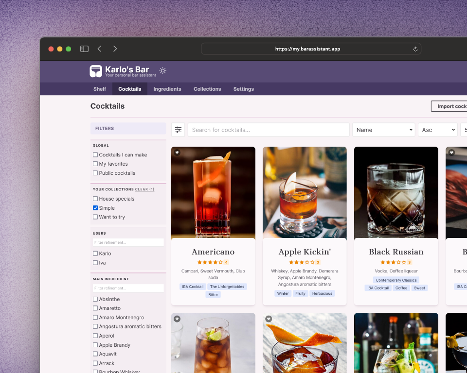

    

    
    
    
    

## 🍸 Bar Assistant

Bar Assistant is an all-in-one solution for managing your home bar. Compared to other recipe management software that usually tries to be more for general use, Bar Assistant is made specifically for managing cocktail recipes. This means that there are a lot of cocktail-oriented features, like ingredient substitutes, first-class ingredients, ABV calculations, unit switching and more.

This repository only contains the API server. If you are looking for an easy-to-use web client, take a look at [Salt Rim](https://github.com/karlomikus/vue-salt-rim).

    <a href="https://demo.barassistant.app/bar/docs" target="_blank">Click here to view API demo.</a>
     
    <a href="https://demo.barassistant.app" target="_blank">Click here to view frontend demo.</a>
     
    <strong>Email:</strong> admin@example.com &middot; <strong>Password:</strong> password

## Features
- [Includes over 500 cocktail recipes with detailed information](https://github.com/bar-assistant/data)
- Includes over 250 base ingredients with categories
- Add and manage multiple bars and bar members
- Fine-grained user control with user roles
- Endpoints for managing and filtering ingredients and cocktails
- Filter recipes by ABV, base ingredient, tags and more
- Filter recipes based on whether you have the right ingredients or not
- Detailed cocktail and ingredient information
- Support for assigning multiple images to resources and image sorting
- Shopping list generation based on missing ingredients in your inventory
- Automatic indexing of data with Meilisearch
- Support for custom cocktail ingredient substitutes
- Support for glass types, utensils, tags, ingredient categories and more
- Cocktail recipe importing via URL, JSON, YAML or custom collections
- Support for cocktail and ingredient ratings and written reviews
- Support for cocktail variations
- Create user-specific cocktail collections for easy referencing and sharing
- Support for cocktail and ingredient notes
- Supports sharing recipes by public links, custom recipe images and printing
- Create public bar menus
- Manage custom API personal access tokens with custom permissions set by users
- Detailed statistics about recipes and user tastes
- Data export support in various formats
- Support for multiple ingredient prices
- Automatic cocktail price calculation based on ingredients
- Single sign-on (SSO) support
- Recipe recommendations based on your favorites and tags
- AI-assisted cocktail and ingredient image generation
- Shelf-photo inventory detection to mark matching ingredients as in stock

## Documentation

[Documentation is available here.](https://docs.barassistant.app/)

## Container images

Bar Assistant is available as a Docker image on [Docker Hub](https://hub.docker.com/r/barassistant/server) and [GitHub Container Registry](https://github.com/karlomikus/bar-assistant/pkgs/container/barassistant). There is no `latest` tag, so you need to specify version in the tag. For example:

- `barassistant/server:6.12.1` - This will pull the exact version
- `barassistant/server:6.12` - This will pull the latest patch release in the 6.12 series
- `barassistant/server:v6` - This will pull the latest major release
- `barassistant/server:dev` - This will pull the latest development version (not recommended for production)

We recommend that you always use the latest major release, as it will always be the most stable version.

## Environment Variables

Here's a list of interesting environment variables you can set to configure Bar Assistant:

|Name|Default|Description|
|----|-------|-----------|
|REDIS_HOST|127.0.0.1|The Redis host.|
|CACHE_DRIVER|redis|The cache driver to use (`file` or `redis`).|
|SESSION_DRIVER|redis|The session driver to use (`file` or `redis`).|
|ALLOW_REGISTRATION|true|Allow or disallow user registration.|
|AUTH_TOKEN_EXPIRATION_DAYS|14|Number of days login tokens remain valid. Set to `0` or a negative value to disable expiration.|
|MAIL_REQUIRE_CONFIRMATION|false|Require email confirmation for new user registrations.|
|MAIL_RESET_URL||URL template for password reset links. Use `[token]` in the URL.|
|MAIL_CONFIRM_URL||URL template for email confirmation links. Use `[id]` and `[hash]` in the URL.|
|MEILISEARCH_HOST|http://localhost:7700|The Meilisearch host URL.|
|MEILISEARCH_KEY||The Meilisearch API key.|
|METRICS_ENABLED|false|Enable or disable the Prometheus metrics endpoint.|
|METRICS_ALLOWED_IPS||Comma-separated list of IPs allowed to access metrics. Use `*` to allow all IPs.|
|ENABLE_PASSWORD_LOGIN|true|Enable or disable password login.|
|SCRAPING_HTTP_PROXY||HTTP proxy URL for web scraping. The proxy must block non-public destination addresses because it may resolve hostnames independently.|
|SCRAPING_CLIENT_CERT||Path to a client certificate for web scraping.|
|MAIL_MAILER|smtp|The mailer to use.|
|MAIL_HOST|smtp.mailgun.org|The mail host.|
|MAIL_PORT|587|The mail port.|
|MAIL_ENCRYPTION|tls|The mail encryption method.|
|MAIL_USERNAME||The mail username.|
|MAIL_PASSWORD||The mail password.|
|GEN_AI_PROVIDER||Identifier of the LLM provider supported by the Laravel AI SDK (e.g. `openai`, `anthropic`, `ollama`).|
|GEN_AI_MODEL||Optional specific text model to use from the provider. Required for `openai-compatible` providers.|
|GEN_AI_IMAGE_PROVIDER||Identifier of an image-capable provider (e.g. `openai`, `gemini`).|
|GEN_AI_IMAGE_MODEL||Optional specific image generation model to use from the provider.|

## Managed instance

Bar Assistant will always be open-source and MIT-licensed, but if you want to support the project or don't want to self-host, you can try our official managed instance. Visit [barassistant.app](https://barassistant.app/) for more information about our cloud offering.

## Third-party integrations

There's an [unofficial Raycast extension](https://www.raycast.com/stupifier/barassistant) maintained by a [community member](https://github.com/zhdenny).

## Contributing

Contributions Welcome!

For more details, see [CONTRIBUTING.md](/CONTRIBUTING.md).

## Support and Donations

Bar Assistant is free, but maintaining any open source project takes time and resources. If you find Bar Assistant valuable and want to support its future development, consider donating.

[Donate with PayPal](https://www.paypal.com/ncp/payment/9L8T4YJZBRXAS)

## License

The Bar Assistant API is open-sourced software licensed under the [MIT license](https://opensource.org/licenses/MIT).
